# AMS — Project Design and Completion Flows

Phạm vi: AMS Course Management (G1–G3). Subject trong yêu cầu được biểu diễn bởi `Course`; Assignment là bài tập thuộc một Course. Các luồng bên dưới bám vào backend Spring Boot, frontend React, MySQL/H2, Google/Mail, SePay và Gemini hiện có.

## 1. Five use case diagrams

### 1. Login System
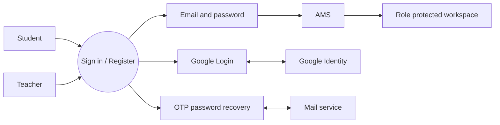

### 2. Manage Courses
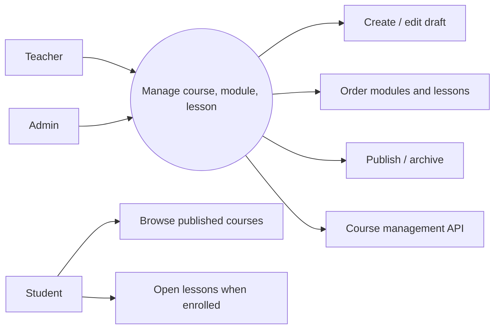

### 3. Manage Subject Assignments
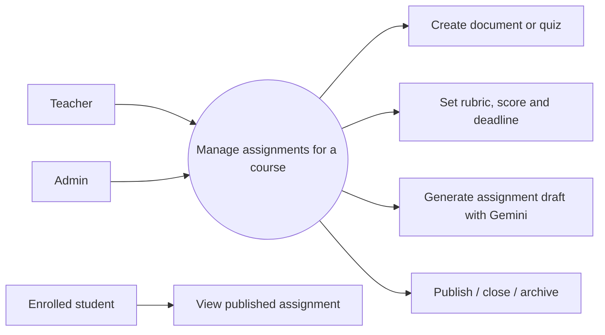

### 4. Enroll Course with Payment
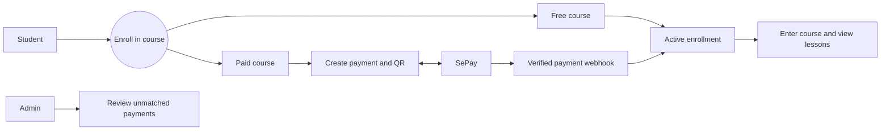

### 5. Submit & Evaluate Assignment with AI
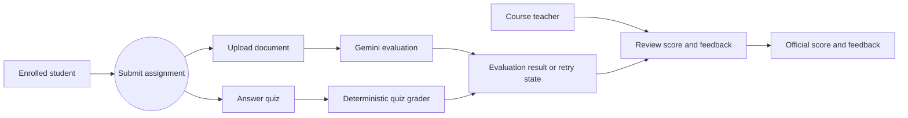

## 2. Five activity diagrams for integrated flows

### 1. Login with Google or email recovery
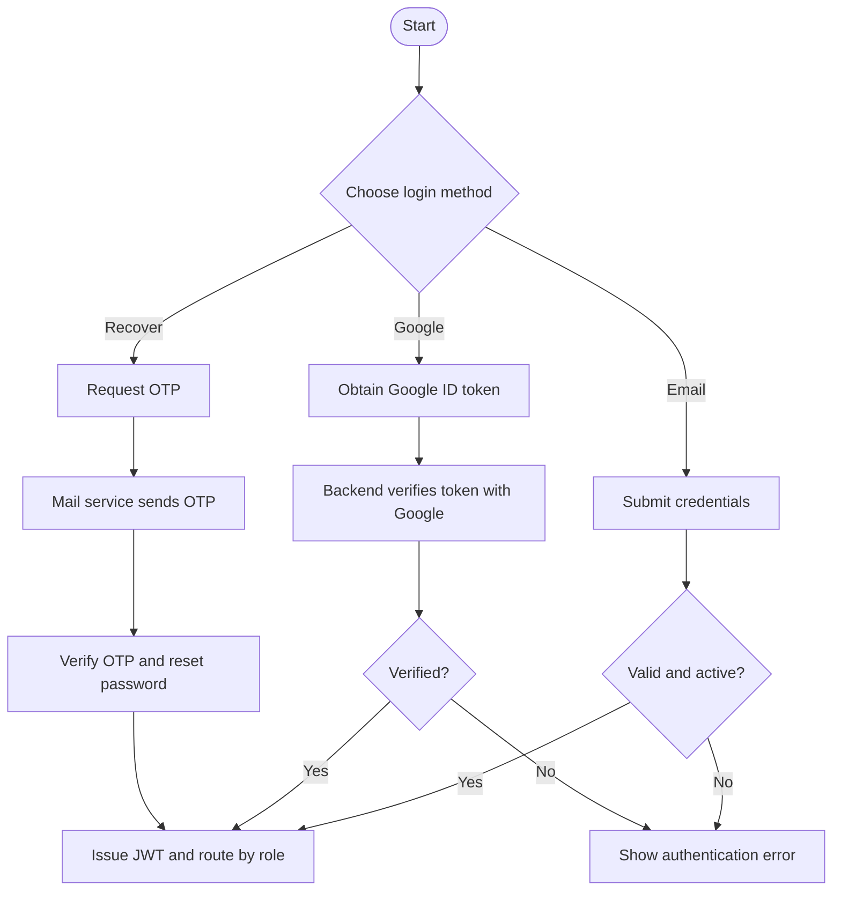

### 2. Manage course curriculum
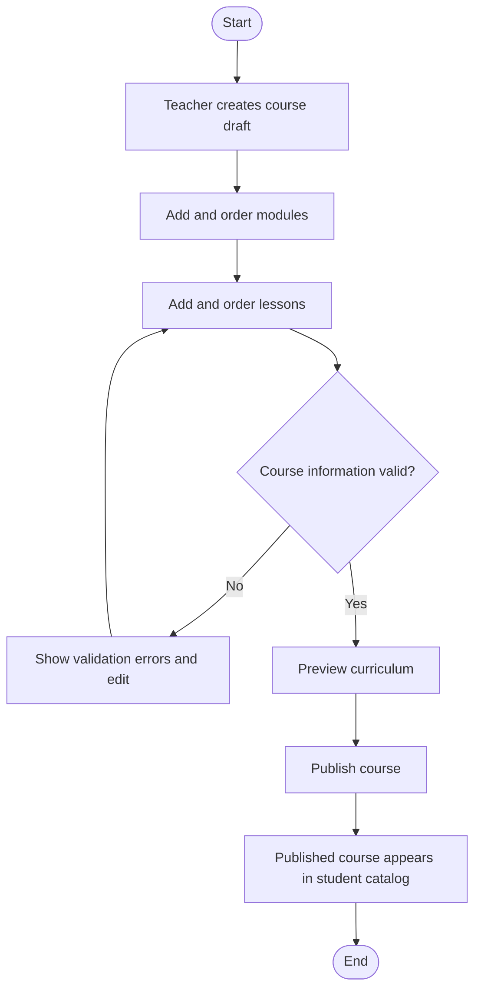

### 3. Create and publish a subject assignment
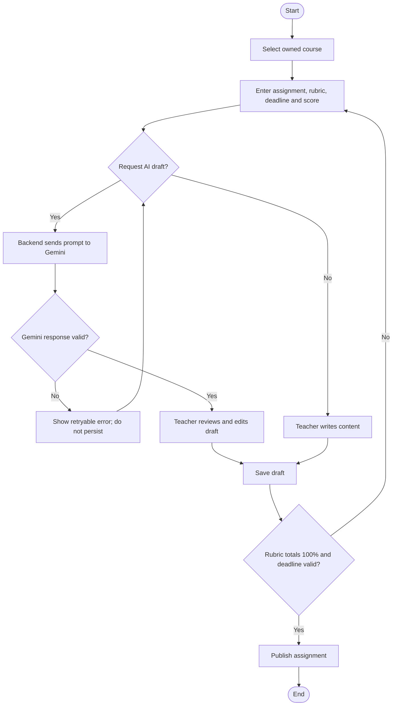

### 4. Enroll, pay and enter the class
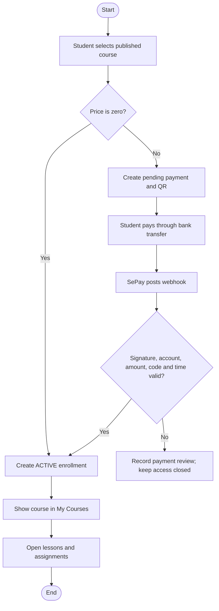

### 5. Submit and evaluate assignment
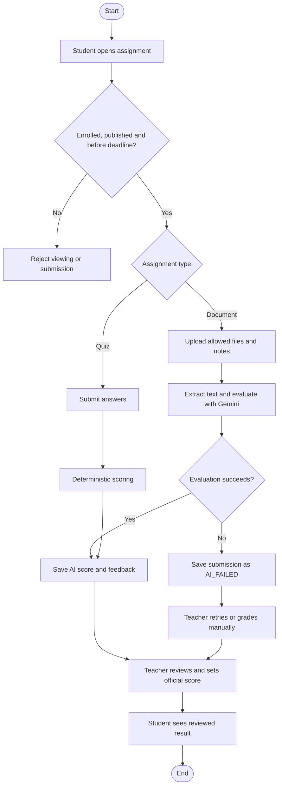

## 3. Five sequence diagrams for external integrations

### 1. Login and recovery
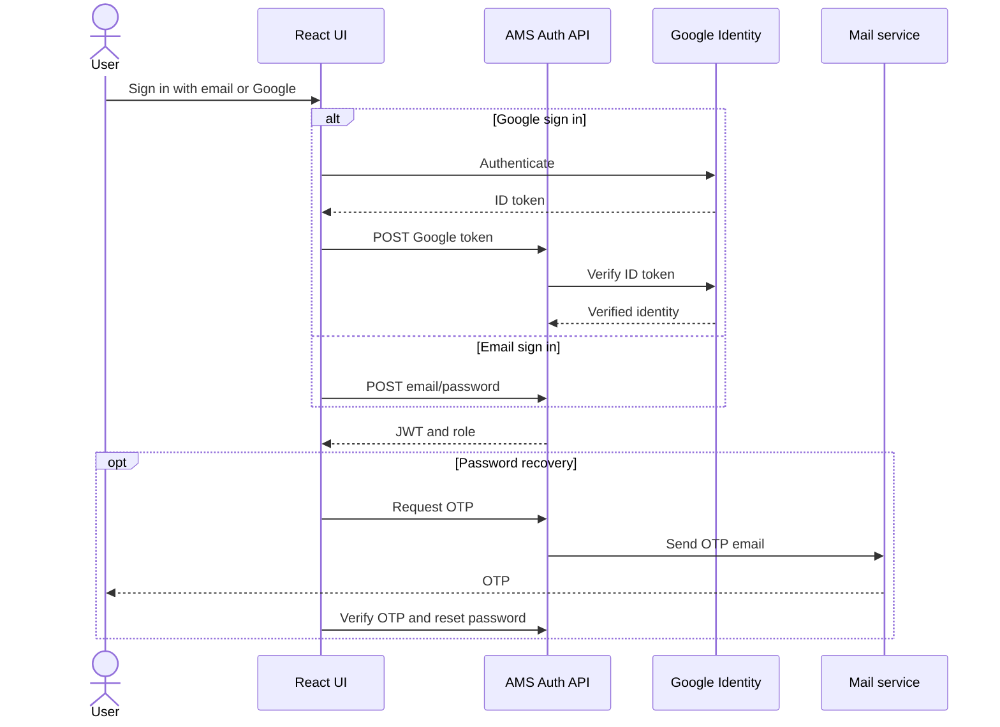

### 2. Course management (no external service in current implementation)
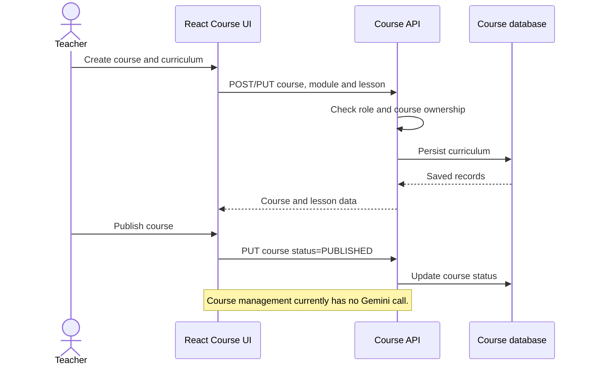

### 3. Assignment generation and publication
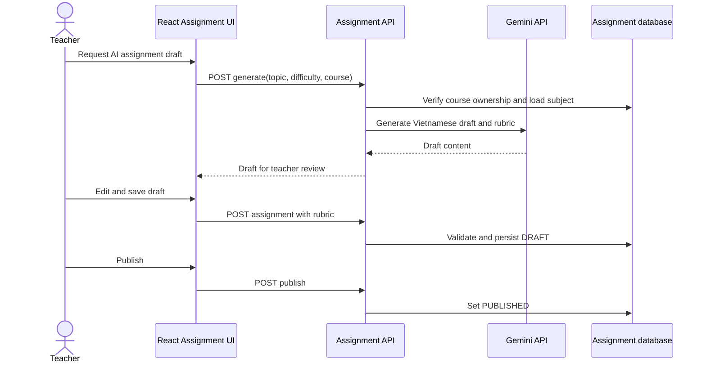

### 4. SePay enrollment payment
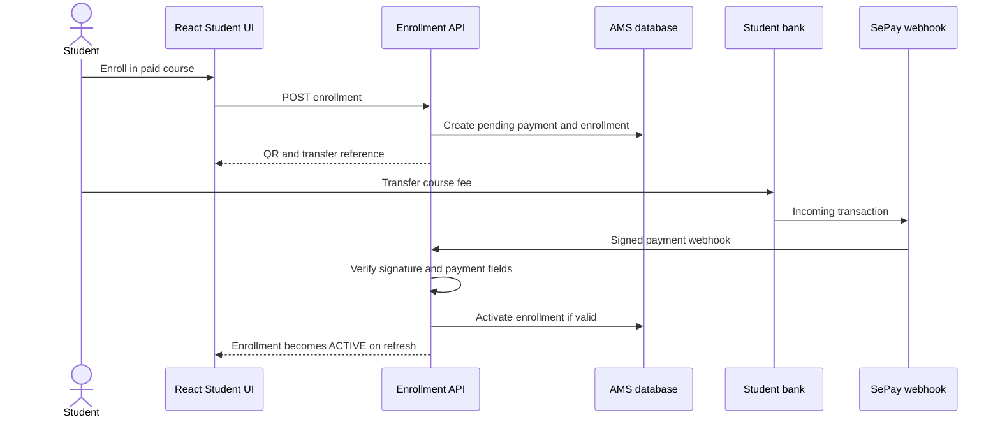

### 5. Submission evaluation and teacher review
```mermaid
sequenceDiagram
  actor Student
  actor Teacher
  participant UI as React Assignment UI
  participant API as Submission API
  participant Gemini as Gemini API
  participant DB as Submission database
  Student->>UI: Submit file or quiz answers
  UI->>API: POST multipart submission
  API->>DB: Verify active enrollment and deadline; save attempt
  alt Document assignment
    API->>Gemini: Evaluate extracted evidence using rubric
    Gemini-->>API: Suggested score and feedback
  else Quiz
    API->>API: Score against answer key
  end
  API->>DB: Save result or AI_FAILED
  API-->>UI: Submission state and result
  Teacher->>UI: Review queue and set official score
  UI->>API: PATCH review
  API->>DB: Save teacher score and feedback
  API-->>UI: TEACHER_REVIEWED result
```

## 4. Shared system diagrams

### System context
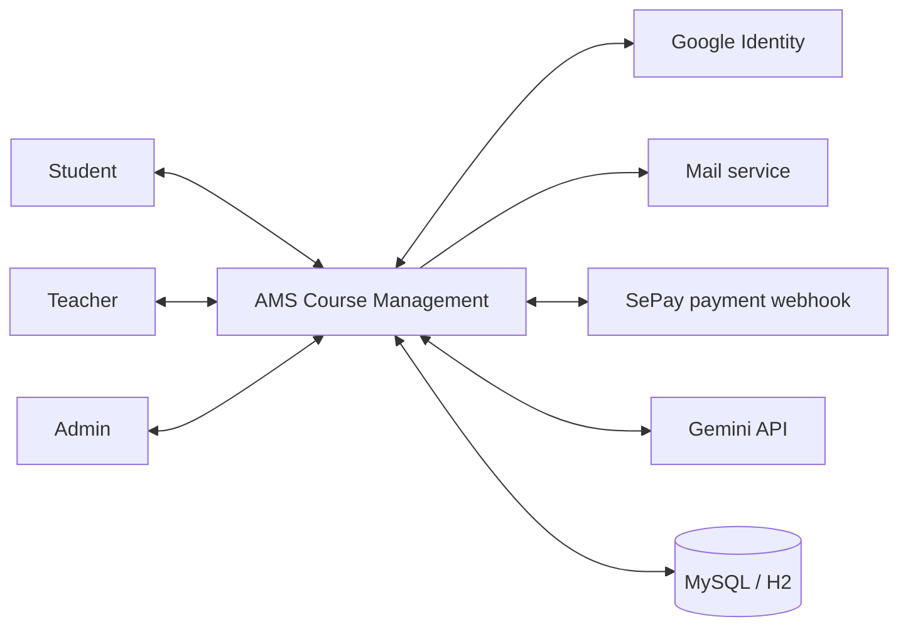

### Entity class diagram
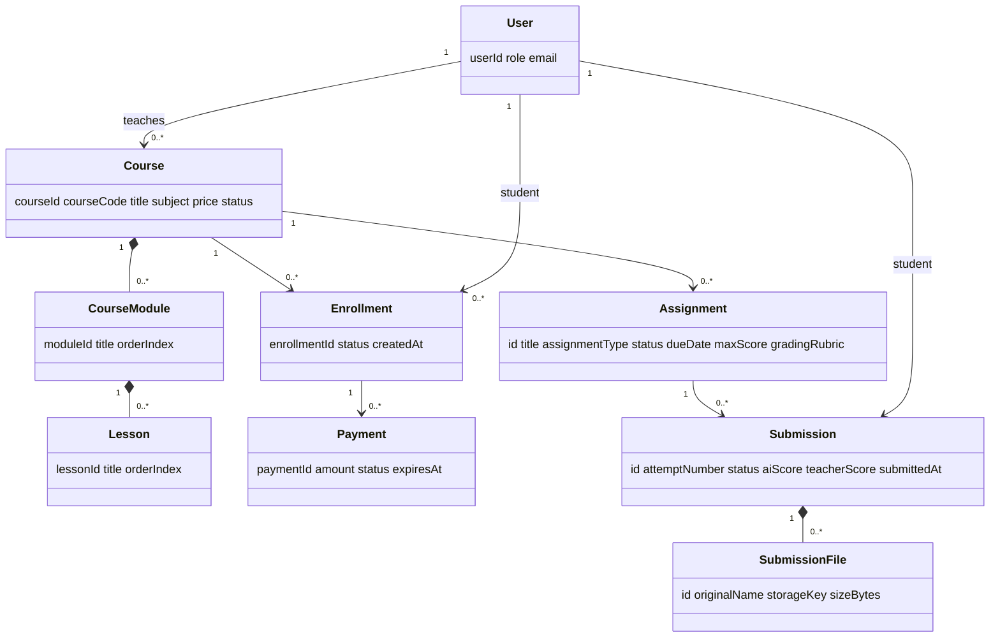

### State transition diagram
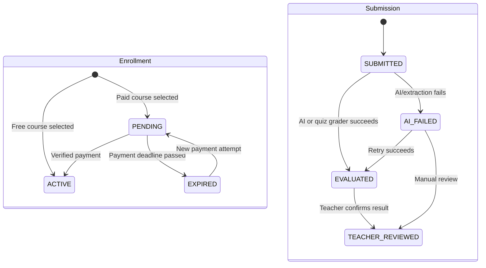

### System architecture
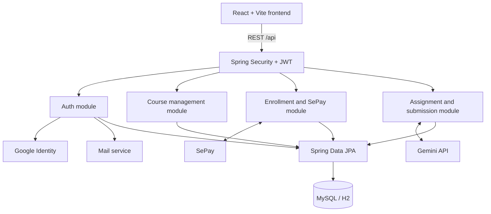

### Database design
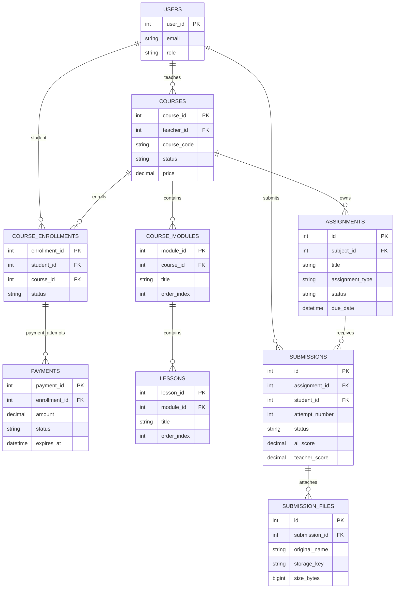

## 5. Five class diagrams (member allocation)

### Member 1 — Login System
```mermaid
classDiagram
  AuthController --> AuthService
  AuthService --> UserRepository
  AuthService --> JwtTokenProvider
  AuthService --> GoogleTokenVerifier
  AuthService --> EmailService
  class User { userId email passwordHash role status }
```

### Member 2 — Manage Courses
```mermaid
classDiagram
  CourseController --> CourseManagementService
  CourseStructureController --> CourseManagementService
  CourseManagementService --> CourseRepository
  CourseManagementService --> CourseModuleRepository
  CourseManagementService --> LessonRepository
  Course "1" *-- "many" CourseModule
  CourseModule "1" *-- "many" Lesson
```

### Member 3 — Manage Subject Assignments
```mermaid
classDiagram
  AssignmentController --> AssignmentService
  AiAssignmentController --> GeminiAiService
  AssignmentService --> AssignmentRepository
  AssignmentService --> AssignmentTemplateRepository
  Assignment "1" --> "many" Criterion : rubric JSON
  Assignment "1" --> "many" Question : optional quiz JSON
```

### Member 4 — Enrollment and Payment
```mermaid
classDiagram
  EnrollmentController --> EnrollmentService
  SepayWebhookController --> SepayWebhookService
  EnrollmentService --> EnrollmentRepository
  EnrollmentService --> PaymentRepository
  SepayWebhookService --> SepayTransactionRepository
  Enrollment "1" --> "many" Payment
  Enrollment --> EnrollmentStatus
  Payment --> PaymentStatus
```

### Member 5 — Submit and Evaluate
```mermaid
classDiagram
  SubmissionController --> SubmissionService
  SubmissionService --> SubmissionRepository
  SubmissionService --> SubmissionFileStorage
  SubmissionService --> SubmissionTextExtractor
  SubmissionService --> GeminiAiService
  Submission "1" *-- "many" SubmissionFile
  Submission --> SubmissionStatus
```

## Implementation status notes

- Course management, student course enrollment/payment access, auth, Gemini assignment drafting and backend submission/evaluation APIs already exist.
- Student dashboard now exposes assignments and supports submission/history/results. Teacher assignment detail now exposes the submission queue, retry, file access and score/feedback review.
- Course management currently has no Gemini integration; the course activity/sequence diagrams intentionally describe its current CRUD/publication flow.
- Payment and Gemini live integrations require environment credentials and external service configuration; local automated tests use controlled fixtures/mocks.
